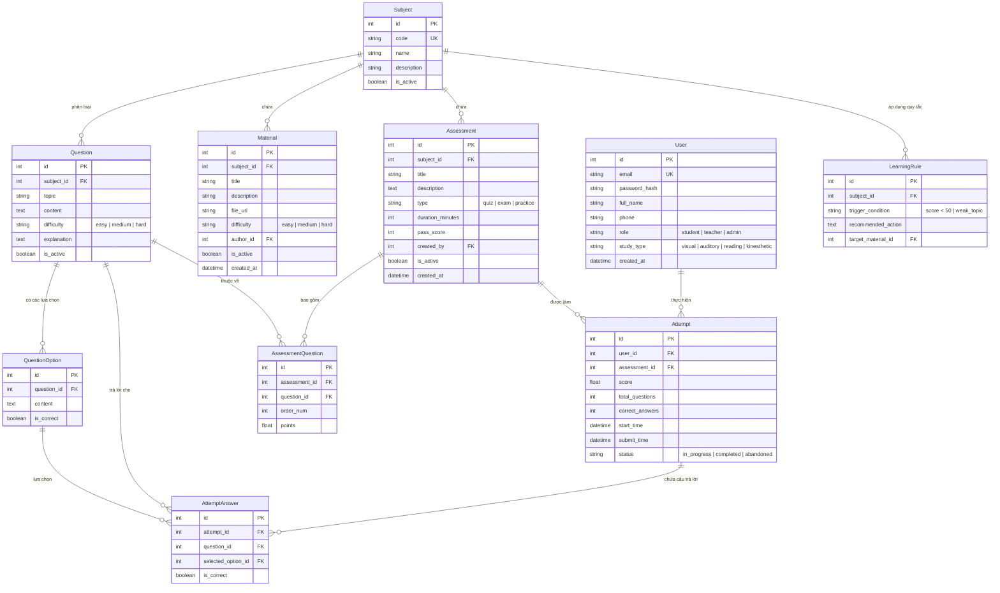
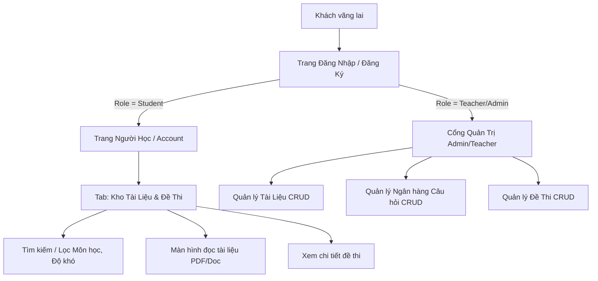

# KẾ HOẠCH TRIỂN KHAI CHI TIẾT SPRINT 1: FOUNDATION
## PHẦN VIỆC BACKEND - FRONTEND (NHÓM 18)

---

## 1. TỔNG QUAN SPRINT 1 & PHẠM VI CÔNG VIỆC DEV

- **Tên Sprint**: Sprint 1 - Foundation (Nền tảng hệ thống)
- **Thời gian thực hiện**: Tuần 10 - Tuần 12 (Trọng tâm Dev: Tuần 11 - 12)
- **Tổng Story Points nhóm Dev đảm nhận**: **27 / 41 SP** (chiếm ~66% khối lượng sprint)
- **Mục tiêu then chốt (Sprint Goal)**:
  1. Thay thế lưu trữ Excel tạm thời bằng CSDL quan hệ chuẩn với 10 thực thể cốt lõi.
  2. Hoàn thiện luồng Xác thực & Phân quyền (Auth + RBAC) cho 3 nhóm vai trò: `Student`, `Teacher`, `Admin`.
  3. Xây dựng Kho tài liệu & Đề thi (Library) có tìm kiếm, lọc đa tiêu chí và phân trang qua API.
  4. Xây dựng Cổng quản trị (Admin/Teacher Portal) thực hiện trọn vẹn quyền CRUD đề thi, câu hỏi và tài liệu học tập.
  5. Sẵn sàng luồng demo: Đăng nhập theo role $\rightarrow$ Kho tài liệu/đề thi $\rightarrow$ Quản trị nội dung $\rightarrow$ Dữ liệu cập nhật thời gian thực.

---

## 2. BẢNG PHÂN RÃ CÔNG VIỆC BACKEND & FRONTEND THEO WBS

| Task ID | Tên công việc | Trách nhiệm | SP | Chi tiết kỹ thuật |
| :--- | :--- | :--- | :---: | :--- |
| **1.3** | **Thiết kế kiến trúc tổng quan & Giao ước API** | Tech Lead / Fullstack | 3 | Chuẩn hóa kiến trúc Flask REST API + Jinja2/Fetch API, tài liệu hoá cấu trúc Request/Response, chuẩn HTTP status code, format phân trang & xử lý lỗi tập trung. |
| **1.4** | **Thiết kế ERD v1, Triển khai DB & Dữ liệu mẫu (Seed Data)** | Backend / DBA | 3 | Chuyển đổi từ các file Excel (`users.xlsx`, `quiz.xlsx`, `tailieu.xlsx`) sang SQLAlchemy ORM với đầy đủ 10 thực thể quan hệ; viết script seed data để test ngay. |
| **1.6** | **Màn hình Đăng nhập/Đăng ký & Cơ chế Xác thực (Auth API + DB)** | Frontend + Backend | 5 | Giao diện form chuẩn UX, Client & Server validation, Hash mật khẩu (Werkzeug/Bcrypt), quản lý phiên (Session/JWT), Middleware bảo vệ route và redirect đúng role. |
| **1.7** | **Kho tài liệu & Đề thi đa chủ đề, phân cấp độ khó** | Frontend + Backend | 8 | **Backend**: API GET phân trang, search, filter theo Subject/Độ khó/Loại.<br>**Frontend**: Giao diện Card/Grid hiển thị metadata phong phú (số câu, tác giả, thời gian), thanh tìm kiếm & bộ lọc reactive, tích hợp trình đọc tài liệu (PDF/Markdown). |
| **1.8** | **Cổng Admin/Giảng viên CRUD bài tập, đề thi, tài liệu** | Backend + Frontend | 8 | **Backend**: API CRUD bảo mật theo role (`Teacher`/`Admin`), kiểm tra toàn vẹn dữ liệu.<br>**Frontend**: Giao diện Quản trị dạng Table/Modal/Form thân thiện, hỗ trợ thêm nhanh câu hỏi trắc nghiệm kèm đáp án đúng/sai, toggle ẩn/hiện (disable). |
| **1.9** | **Tích hợp & Kiểm thử luồng liên thông (Integration Testing)** | QA + Backend + Frontend | 3 | Khớp nối Frontend & Backend, kiểm thử bảo mật route, kiểm thử phân trang và tìm kiếm ranh giới, sửa lỗi tồn đọng trước buổi review. |

---

## 3. THIẾT KẾ CƠ SỞ DỮ LIỆU (ERD V1 - 10 THỰC THỂ)

Theo đúng tiêu chí nghiệm thu của Task 1.4, hệ thống chuyển đổi từ các bảng Excel rời rạc sang CSDL quan hệ chuẩn (sử dụng **SQLAlchemy** trên **SQLite/PostgreSQL**):



---

## 4. ĐẶC TẢ GIAO ƯỚC API (API SPECIFICATION)

### 4.1. Định dạng phản hồi chuẩn (Standard Response Envelope)
Tất cả các API tuân theo cấu trúc JSON đồng nhất:
```json
{
  "success": true,
  "data": {},
  "message": "Thành công",
  "pagination": {
    "page": 1,
    "limit": 10,
    "total_records": 45,
    "total_pages": 5
  }
}
```

### 4.2. Danh sách Endpoints Sprint 1

#### A. Xác thực & Tài khoản (Auth API)
- `POST /api/auth/register`: Đăng ký tài khoản người học.
  - Body: `{ email, password, full_name, phone, study_type }`
- `POST /api/auth/login`: Xác thực và cấp phiên làm việc.
  - Body: `{ email, password }`
  - Response: Cookie phiên/JWT + thông tin `{ id, email, full_name, role }`
- `POST /api/auth/logout`: Hủy phiên đăng nhập.
- `GET /api/auth/me`: Lấy thông tin user hiện tại (kiểm tra token/session hợp lệ).

#### B. Kho Tài liệu & Đề thi (Public / Student Endpoints)
- `GET /api/subjects`: Danh sách môn học đang hoạt động (`is_active = true`).
- `GET /api/materials`: Danh sách tài liệu học tập kèm tìm kiếm và phân trang.
  - Query params: `?search=...&subject_id=...&difficulty=...&page=1&limit=9`
- `GET /api/materials/<id>`: Chi tiết tài liệu và đường dẫn xem file.
- `GET /api/assessments`: Danh sách đề thi / bài test.
  - Query params: `?search=...&subject_id=...&type=...&page=1&limit=9`
- `GET /api/assessments/<id>`: Xem thông tin tổng quan của đề thi (số câu, thời lượng, yêu cầu).

#### C. Quản trị Nội dung (Admin & Teacher Protected Endpoints)
> **Yêu cầu bảo mật**: Kiểm tra `role in ['teacher', 'admin']` qua decorator `@role_required(['teacher', 'admin'])`.
- `POST /api/admin/materials`: Thêm tài liệu mới (hỗ trợ upload PDF hoặc file URL).
- `PUT /api/admin/materials/<id>`: Cập nhật thông tin tài liệu.
- `DELETE /api/admin/materials/<id>`: Soft-delete (`is_active = false`) hoặc xóa tài liệu.
- `POST /api/admin/questions`: Tạo câu hỏi mới kèm danh sách các options (đáp án đúng/sai).
- `PUT /api/admin/questions/<id>`: Cập nhật câu hỏi và options.
- `DELETE /api/admin/questions/<id>`: Xóa hoặc vô hiệu hóa câu hỏi.
- `POST /api/admin/assessments`: Tạo đề thi mới và gán câu hỏi từ ngân hàng câu hỏi.
- `PUT /api/admin/assessments/<id>`: Chỉnh sửa đề thi, thời gian làm bài, cấu trúc câu hỏi.
- `PATCH /api/admin/assessments/<id>/toggle-status`: Kích hoạt / Tắt đề thi (`is_active`).

---

## 5. THIẾT KẾ VÀ PHÁT TRIỂN GIAO DIỆN FRONTEND

### 5.1. Cấu trúc màn hình và luồng điều hướng (Navigation Flow)


### 5.2. Chi tiết các trang giao diện (UI Components)

1. **Màn hình Login & Register (`login.html`, `register.html`)**:
   - Hiện đại hóa giao diện hiện có, bỏ các trường thừa.
   - Thêm dropdown chọn phong cách học tập (`study_type`: Visual, Auditory, Reading/Writing, Kinesthetic).
   - Validation phía client (email format, độ dài password, mật khẩu trùng khớp) hiển thị thông báo lỗi tức thời mà không cần reload trang.
   - Thông báo Flash message cảnh báo khi sai tài khoản hoặc đăng xuất thành công.

2. **Kho Tài liệu & Đề thi (`account.html` hoặc `library.html`)**:
   - **Thanh công cụ lọc (Filter Toolbar)**: Ô tìm kiếm từ khóa theo thời gian thực (debounce), dropdown chọn Môn học (`Subject`), tabs chuyển đổi giữa "Tài liệu học tập" và "Đề thi đánh giá", bộ lọc độ khó (Dễ - Trung bình - Khó).
   - **Lưới thẻ (Card Grid Display)**: 
     - Thẻ tài liệu: Tiêu đề, môn học, tác giả, huy hiệu độ khó, nút "Đọc tài liệu" (mở modal/tab đọc PDF).
     - Thẻ đề thi: Tên đề, thời gian (phút), số lượng câu hỏi, số điểm đạt, nút "Bắt đầu làm bài" (chuẩn bị cho Sprint 2).
   - **Thanh phân trang (Pagination Bar)**: Chuyển trang mượt mà (AJAX Fetch API không làm nháy trang).

3. **Cổng Quản trị Admin / Giảng viên (`admin_dashboard.html`)**:
   - Bố cục Sidebar + Main Content (Quản trị môn học / Tài liệu / Câu hỏi / Đề thi).
   - **Bảng danh sách (Data Tables)**: Hiển thị đầy đủ cột, trạng thái kích hoạt (badge xanh/xám), các nút hành động: Xem, Sửa, Vô hiệu hóa (Soft Delete).
   - **Form tạo/sửa động**:
     - Form thêm câu hỏi: Nhập nội dung câu hỏi, độ khó, môn học, thêm động 4 lựa chọn (A, B, C, D) với radio button chọn đáp án chính xác, phần giải thích (explanation).
     - Form tạo đề thi: Nhập metadata, chọn danh sách câu hỏi từ ngân hàng câu hỏi để đưa vào đề thi.

---

## 6. LỘ TRÌNH THỰC HIỆN CHI TIẾT (TIMELINE TUẦN 11 - 12)

```
Tuần 11 (Ngày 1 - 3): Khởi tạo Kiến trúc & Database
  ├── [BE] Khởi tạo SQLAlchemy models (10 bảng), DB migrate script
  ├── [BE] Viết seed data mẫu từ các file Excel cũ
  └── [FE] Rà soát layout tổng thể, chuẩn bị component styles (CSS/JS)

Tuần 11 (Ngày 4 - 7): Module Xác thực (Auth) & Phân quyền (RBAC)
  ├── [BE] Xây dựng Auth API, Decorators kiểm tra role, quản lý Session/Cookie
  ├── [FE] Nâng cấp màn hình Login/Register, client validation & error handling
  └── [Integration] Kiểm tra đăng nhập và redirect đúng màn hình theo Role

Tuần 12 (Ngày 8 - 10): Module Kho Tài Liệu & Đề Thi (Task 1.7)
  ├── [BE] Viết API GET /api/materials & /api/assessments (search, filter, pagination)
  ├── [FE] Xây dựng UI Library: Thẻ tài liệu, thanh filter môn/độ khó, phân trang AJAX
  └── [FE+BE] Tích hợp màn hình xem tài liệu (PDF viewer/reading layout)

Tuần 12 (Ngày 11 - 13): Module Admin/Giảng viên CRUD (Task 1.8)
  ├── [BE] Hoàn thiện các API CRUD bảo vệ cho Materials, Questions, Assessments
  ├── [FE] Xây dựng Admin Dashboard, modal/form tạo đề thi & câu hỏi
  └── [Integration] Kiểm thử luồng: Admin tạo câu hỏi/đề thi -> Người học thấy trên kho

Tuần 12 (Ngày 14): Kiểm thử Tổng thể & Demo Sprint 1 (Task 1.9)
  ├── Chạy test case kiểm thử toàn bộ luồng
  ├── Tinh chỉnh hiệu năng và giao diện
  └── Chuẩn bị kịch bản demo cho buổi nghiệm thu Sprint 1
```

---

## 7. KẾ HOẠCH CHUYỂN ĐỔI DỮ LIỆU (DATA MIGRATION TỪ EXCEL SANG DB)

Do hiện tại mã nguồn đang đọc trực tiếp từ các file Excel (`users.xlsx`, `tailieu.xlsx`, `quiz.xlsx`, `ScoreDatabase.xlsx`), bước chuyển đổi trong Sprint 1 cần được thực hiện an toàn qua script tự động:

1. **`users.xlsx` $\rightarrow$ Bảng `users`**:
   - Đọc email, phone, studytype, giữ nguyên password_hash đã có trong Excel.
   - Thêm cột `role`: Gán mặc định tài khoản admin/teacher cho các email phụ trách và `student` cho người học.
2. **`tailieu.xlsx` $\rightarrow$ Bảng `subjects` & `materials`**:
   - Trích xuất danh mục môn học (`Subject`) vào bảng `subjects`.
   - Lưu tên file PDF/Doc và liên kết với môn học tương ứng.
3. **`quiz.xlsx` $\rightarrow$ Bảng `questions` & `question_options`**:
   - Đọc câu hỏi, chủ đề, độ khó.
   - Phân rã 4 cột (Option 1, Option 2, Option 3, Option 4) thành 4 bản ghi trong bảng `question_options`, đánh dấu `is_correct = true` theo cột Correct Answer.
4. **Tạo dữ liệu mẫu cho `assessments` & `assessment_questions`**:
   - Nhóm các câu hỏi vừa import thành 1-2 bộ đề thi mẫu (Assessment) để phục vụ test và hiển thị.

---

## 8. TIÊU CHÍ HOÀN THÀNH (DEFINITION OF DONE - DOD) SPRINT 1

- [ ] **Database**: Đầy đủ 10 bảng trong CSDL với khóa chính, khóa ngoại, indexes hợp lệ; chạy seed data không lỗi.
- [ ] **Auth**: Đăng ký, đăng nhập thành công; mật khẩu hash an toàn; đăng xuất xóa sạch session; chặn truy cập trái phép.
- [ ] **Role Routing**: Học sinh đăng nhập vào trang người học; Giáo viên/Admin đăng nhập vào trang quản trị.
- [ ] **Kho tài liệu**: Tìm kiếm từ khóa và lọc theo môn học/độ khó trả về đúng kết quả; phân trang hoạt động chuẩn.
- [ ] **CRUD Admin**: Tạo mới, sửa, bật/tắt (disable) được bài tập, đề thi và tài liệu; API trả mã lỗi 403 khi tài khoản không đủ quyền.
- [ ] **Code Quality**: Code có cấu trúc rõ ràng, tách biệt routes/controllers, models, templates/views; không còn đọc/ghi file Excel trong luồng chính.
- [ ] **Sẵn sàng Demo**: Thực hiện trơn tru kịch bản demo từ Login $\rightarrow$ Tìm tài liệu $\rightarrow$ Admin cập nhật nội dung $\rightarrow$ Học sinh thấy nội dung mới.
